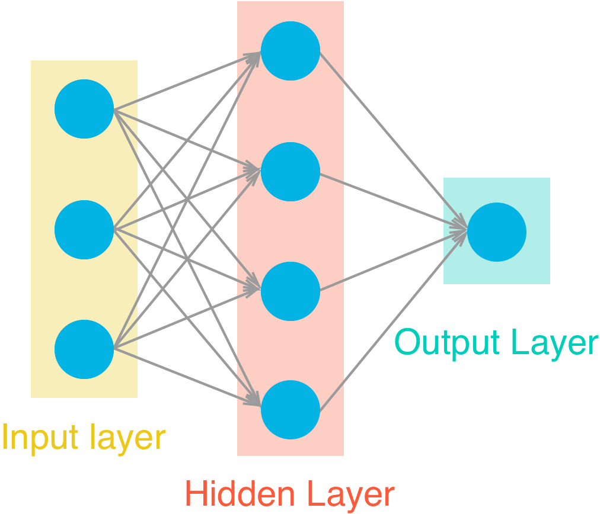
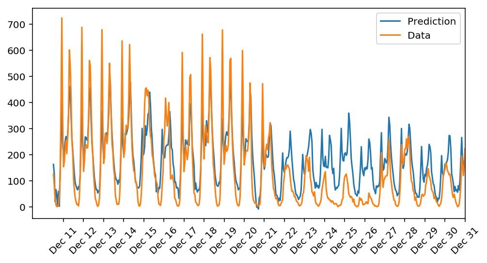
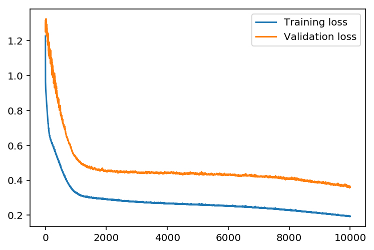

# Bike Rental Predictor 🚲📈

Predict hourly bike-sharing demand using a simple feed-forward neural network implemented **from scratch** in NumPy.



## Overview
This project trains a shallow neural network (one hidden layer) on the [UCI Bike Sharing Dataset](https://archive.ics.uci.edu/ml/datasets/bike+sharing+dataset) to forecast the number of bikes that will be rented in the next hour. The implementation purposefully avoids high-level frameworks such as TensorFlow or PyTorch, making it an excellent learning resource for understanding the mechanics of forward and backward propagation.

## Features
• End-to-end pipeline – raw CSV ➜ feature engineering ➜ model training ➜ evaluation  
• Pure NumPy implementation of a feed-forward neural-network  
• Easy-to-tweak hyper-parameters exposed at the top of `bike_rental_predictor.py`  
• Visualisations of the learning curve and predictions saved to the `results/` directory  
• Reproducible environment description via `linear-regression.yml` (conda)

---

## Quickstart

### 1. Clone & install dependencies

```bash
git clone https://github.com/<your-username>/bike-rental-predictor.git
cd bike-rental-predictor

# create and activate env (recommended)
conda env create -f linear-regression.yml
conda activate linear-regression          # or "source activate ..." on Linux / macOS
```

_No conda?_ Use plain `pip` instead:

```bash
python -m venv .venv && source .venv/bin/activate
pip install numpy pandas matplotlib
```

### 2. Train the model

```bash
python bike_rental_predictor.py
```

The script prints training progress and opens a Matplotlib window comparing predictions with ground-truth rentals for the last three weeks (also exported to `results/`).

### 3. Notebook version

Prefer an interactive walk-through? Open the included Jupyter notebook:

```bash
jupyter notebook bike_rental_predictor.ipynb
```

---

## Hyper-parameters

The following defaults yield a validation error below ~0.14:

```python
iterations     = 4000
learning_rate  = 0.075
hidden_nodes   = 10
output_nodes   = 20
```

Feel free to experiment – the code is only ~200 lines!

---

## Results

Below is an example of the model’s predictions (blue) vs. the real demand (orange) on unseen data:



Training vs. validation loss:



More examples are available in the `results/` folder.

---

## Repository structure

```
├── Bike-Sharing-Dataset/   # raw data (hour.csv & day.csv)
├── assets/                 # images used in this README
├── results/                # generated plots
├── bike_rental_predictor.py
├── bike_rental_predictor.ipynb
├── linear-regression.yml   # conda environment spec
└── tests.py                # unit tests for key functions
```

---

## Dataset

The project relies on the [Bike Sharing Dataset](https://archive.ics.uci.edu/ml/datasets/bike+sharing+dataset) compiled by Fanaee-T and Gama (2013). The data is distributed under the [Creative Commons BY-SA 3.0](https://creativecommons.org/licenses/by-sa/3.0/) license.

---

## Contributing

Pull requests are welcome! To get started:

1. Open an issue describing the change.  
2. Fork the repository and create a feature branch.  
3. Commit your changes (+ tests if applicable).  
4. Submit a PR 🚀

---

## License

This project is released under the MIT License – see the [LICENSE](LICENSE) file for details.

---

## Acknowledgements

Inspired by Udacity’s "Deep Learning Foundation" course and by the original research by Fanaee-T and Gama.
